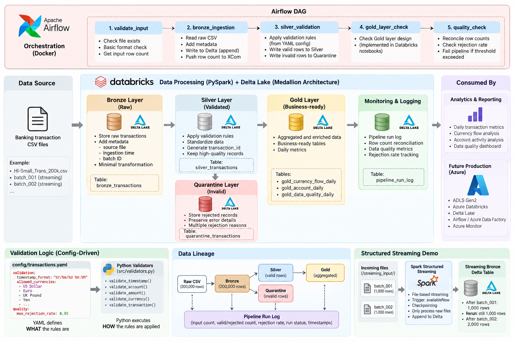

# Banking Transaction Data Pipeline

**A Config-Driven Data Engineering Project**

An end-to-end banking transaction data engineering project demonstrating data ingestion, quality validation, incremental processing, workflow orchestration, and streaming.

## Architecture

The project separates data processing, orchestration, validation, and monitoring into modular components.

### Data Flow

Raw CSV → Bronze → Silver / Quarantine → Gold

- **Bronze:** Stores raw transactions with ingestion metadata.
- **Silver:** Contains validated and standardized transactions.
- **Quarantine:** Preserves rejected records and their rejection reasons.
- **Gold:** Provides aggregated business and data quality metrics.

## Technology Stack

Python · PySpark · Databricks · Delta Lake · Apache Airflow · Docker · YAML · pytest
